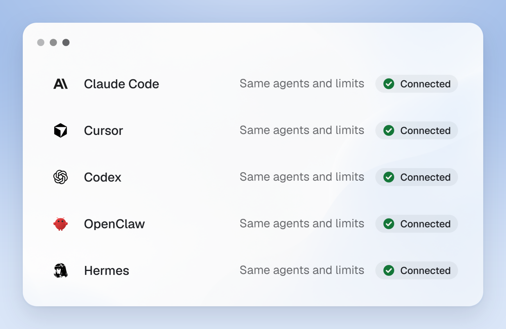

# Proofable MCP

[](https://www.npmjs.com/package/@proofable/mcp)
[](./LICENSE)

Connect once, and every AI tool you use knows your work and follows your rules.

One profile carries your context, agents, skills and keys, loaded with only what is true now. Each action is checked before it runs, and every job leaves a receipt you can check.

<p align="center"></p>

## Connect in one click

<a href="https://cursor.com/en/install-mcp?name=proofable&config=eyJ1cmwiOiJodHRwczovL21jcC5wcm9vZmFibGUubWUvbWNwIn0%3D"></a>
<a href="https://vscode.dev/redirect/mcp/install?name=proofable&config=%7B%22type%22%3A%22http%22%2C%22url%22%3A%22https%3A%2F%2Fmcp.proofable.me%2Fmcp%22%7D"></a>
<a href="https://chatgpt.com/plugins/plugin_asdk_app_6ae65c2bac0881918812c63246c7e6c9"></a>

Claude Code installs the server and its skills together:

```text
/plugin marketplace add proofable/mcp
/plugin install proofable-mcp@proofable
```

Codex and the other supported clients, from a terminal:

```bash
npx -y @proofable/sdk setup
```

In Claude and any other app with connectors, add `https://mcp.proofable.me/mcp` as a custom connector. A standard MCP configuration:

```json
{
  "mcpServers": {
    "proofable": {
      "type": "http",
      "url": "https://mcp.proofable.me/mcp"
    }
  }
}
```

Keep one Proofable connection per client. A plugin plus a manual entry creates a duplicate. [Setup for every client](https://docs.proofable.me/mcp/setup)

## First prompt

After sign-in, ask:

```text
Show my Proofable profile, my agents and what each one is allowed to do.
```

For a specific requirement:

```text
Check whether I already have the proof needed for this task. Reuse it if it qualifies; otherwise show me the next step.
```

## What agents can do

18 tools, every client, every plan.

| Outcome | Tools |
|---|---|
| Load your profile, proofs, agents and credits | `proofable_context` |
| Reuse a proof, or get the next step to one | `proofable_verify_or_guide` |
| See every check and its inputs | `proofable_verifiers_catalog` |
| Gate on a proof: pass or fail | `proofable_proofs_check` |
| Prove it | `proofable_verify` |
| Prove it with another wallet's signature | `proofable_verify_prepare`, `proofable_verify_submit` |
| Read, edit or review proofs | `proofable_proofs_get`, `proofable_proofs_update` |
| Revoke a proof or an agent permission | `proofable_proof_revoke` |
| Add an agent, check its permission, run as it | `proofable_agent_create`, `proofable_agent_link`, `proofable_agent_mount` |
| Hand work to an agent and follow it | `proofable_job_create`, `proofable_job_get`, `proofable_job_list`, `proofable_job_decide`, `proofable_job_cancel` |

Call `proofable_context` once after connecting. Proofable reuses current proofs before starting another verification and returns **Passed**, **Action needed**, or **Blocked**.

The [MCP tool reference](https://docs.proofable.me/mcp/tools) lists every tool with its inputs and result shapes.

## Servers and automation

Create an access key in [your account settings](https://proofable.me/profile?tab=account), store it as `PROOFABLE_ACCESS_KEY`, and send it as a Bearer token. Keep access keys out of source code, browser bundles, and chat.

```json
{
  "mcpServers": {
    "proofable": {
      "type": "http",
      "url": "https://mcp.proofable.me/mcp",
      "headers": {
        "Authorization": "Bearer ${PROOFABLE_ACCESS_KEY}"
      }
    }
  }
}
```

## Examples

- [Prompt injection test](./examples/injection-test): hides AgentDojo attacks in a note your agent reads, runs the task under a scoped and a broad permission, and grades every run from its signed receipt.
- [Guarded agent action](./examples/guarded-agent-action): makes one permission decision before host code runs a tool.

## Build with Proofable

Use the [Proofable SDK](https://github.com/proofable/sdk) for application code, verification gates, and the CLI. This repository carries the MCP registry manifest, the host plugins, and the workflow skills; the server runs at `https://mcp.proofable.me/mcp`.

## Support

- [Documentation](https://docs.proofable.me/mcp/overview)
- [Issues](https://github.com/proofable/mcp/issues)
- [Security](./SECURITY.md)
- [Contributing](./CONTRIBUTING.md)

Apache-2.0. Proofable is published by NEUS Network, Inc.
